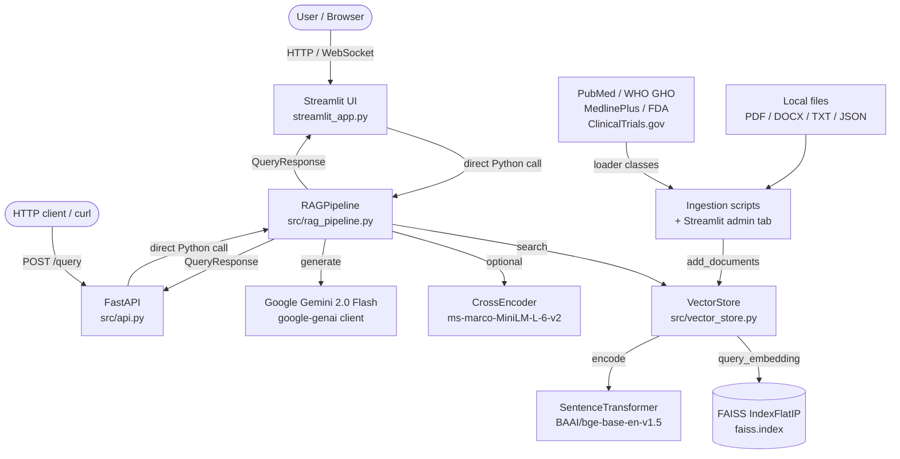

# MEDSOURCE — Project Technical Understanding

> **Generated by deep inspection of actual source code (not README only).** Each claim carries a verification tag:
> `[verified]` = confirmed in source, `[partial]` = partially confirmed, `[unverified]` = README-only,
> `[not found]` = claimed but absent, `[unknown]` = insufficient information.
>
> Secrets are redacted. No files were modified.

---

## 1. Project Purpose and Technology Stack

MedSource is a **Retrieval-Augmented Generation (RAG) chatbot** for medical Q&A. Its central premise: every factual claim must be traceable to a cited document; when retrieval confidence falls below a configurable threshold the answer is explicitly labelled as general knowledge. `[verified]`

### Technology Stack

| Layer | Implementation | Version Constraint | Status |
|---|---|---|---|
| Frontend | Streamlit (`streamlit_app.py`) | `>=1.38.0` | `[verified]` |
| Backend API | FastAPI (`src/api.py`) | `>=0.109.0` | `[verified]` |
| LLM | Google Gemini 2.0 Flash via `google-genai` | `>=0.8.0` | `[verified]` |
| Embeddings | `BAAI/bge-base-en-v1.5` (768-dim) via sentence-transformers | `>=2.5.1` | `[verified]` |
| Vector store | FAISS `IndexFlatIP` (exact cosine) | `faiss-cpu>=1.7.0` | `[verified]` |
| Re-ranker (optional) | `cross-encoder/ms-marco-MiniLM-L-6-v2` via sentence-transformers | lazy-loaded on first use | `[verified]` |
| Text splitting | LangChain `RecursiveCharacterTextSplitter` (token-aware, tiktoken cl100k_base) | `langchain-text-splitters>=0.3.0` | `[verified]` |
| Config | Pydantic Settings (`.env` file), `lru_cache` singleton | `pydantic-settings>=2.1.0` | `[verified]` |
| Auth | `X-API-Key` header (`FastAPI APIKeyHeader`); blank = disabled | — | `[verified]` |
| Rate limiting | SlowAPI, 10 req/min per IP | `>=0.1.9` | `[verified]` |
| CORS | `CORSMiddleware` with explicit allowlist | — | `[verified]` |
| Containerisation | Docker `python:3.11-slim`, gunicorn + uvicorn worker | — | `[verified]` |
| Deployment | Render.com free tier (`render.yaml`) | — | `[verified]` |
| Python | 3.11+ (`runtime.txt` = 3.11.10) | — | `[verified]` |

---

## 2. Directory Structure

```
project-root/
├── streamlit_app.py          # Streamlit UI — 5 tabs, safety logic, session state (~2,033 lines)
├── src/
│   ├── __init__.py           # Package init (version 1.0.0)
│   ├── api.py                # FastAPI app — lifespan, /query, /health, /stats
│   ├── config.py             # Pydantic Settings (lru_cache singleton)
│   ├── models.py             # QueryRequest, QueryResponse, Source, HealthResponse
│   ├── rag_pipeline.py       # Core RAG: retrieve → re-rank → confidence gate → generate
│   ├── vector_store.py       # FAISS + BGE embedding + token-aware chunking
│   └── data_ingestion.py     # MedicalDocument + 6 loader classes + MedicalCorpusBuilder
├── scripts/
│   ├── ingest_data.py        # CLI ingestion runner (argparse, 7 source types)
│   ├── bootstrap_data.py     # Full-corpus bootstrap (all 5 public APIs)
│   ├── pubmed_append.py      # Resumable PubMed batch fetcher (checkpoint JSON)
│   ├── expand_corpus.py      # Gap-fill: paediatrics, drug interactions, mental health
│   ├── reembed_vector_store.py   # Re-embed when switching embedding models
│   ├── calibrate_confidence.py   # Measure BGE score distribution on live queries
│   ├── audit_sources.py      # Verify source labels in the index
│   └── run_ragas_eval.py     # RAGAS evaluation (faithfulness, answer relevance)
├── data/
│   ├── raw_documents/        # Source JSON saved after each ingest run
│   ├── vector_store/         # faiss.index + documents.pkl + config.pkl (git-ignored)
│   └── processed/            # Optional processed corpus dumps
├── examples/
│   ├── demo.py               # HTTP demo (queries the running FastAPI server)
│   └── direct_usage.py       # In-process demo (uses src/ directly)
├── _test_run.py              # Smoke test suite (no API key or vector store required)
├── _check_eval_prereqs.py    # Quick eval prerequisite checker
├── requirements.txt          # Runtime dependencies
├── requirements-eval.txt     # Additional deps for RAGAS evaluation only
├── .env.example              # Full config template (redacted)
├── Dockerfile                # Python 3.11-slim image
├── docker-compose.yml        # Local Docker setup
├── render.yaml               # Render.com deployment config
├── runtime.txt               # Python 3.11.10 (for Render)
└── MEDSOURCE_PROJECT_UNDERSTANDING.md  # This file
```

---

## 3. Architecture Diagram



---

## 4. Startup Flow and Frontend-Backend Communication

### FastAPI startup (`src/api.py`)
1. `lifespan()` (FastAPI asynccontextmanager) fires on process start. `[verified]`
2. `VectorStore` is instantiated with model/chunking config from `get_settings()`.
3. If `./data/vector_store` exists, `VectorStore.load()` reads `faiss.index`, `documents.pkl`, and `config.pkl`. `[verified]`
4. `RAGPipeline` is instantiated with `genai.Client(api_key=…)`. Model name defaults to `gemini-2.0-flash` if `LLM_MODEL` is blank. `[verified]`
5. Globals `vector_store` and `rag_pipeline` are set. They remain `None` if any step fails — the exception is caught and logged but startup continues. The API will return `503` on all requests until both are set. `[verified]`

### Streamlit startup (`streamlit_app.py`)
1. `load_dotenv()` at module-level loads `.env`. `[verified]`
2. `load_vector_store()` is a `@st.cache_resource` function — loads on first call, cached for the process lifetime. `[verified]`
3. `build_pipeline(vs_chunk_count)` is also `@st.cache_resource`, keyed by chunk count so the cache auto-invalidates when new docs are ingested. `[verified]`
4. **Both the Streamlit app and FastAPI backend instantiate their own `VectorStore` and `RAGPipeline` objects independently** — they do not share state at runtime. If the FastAPI server is not running, the Streamlit app still works directly via Python. `[verified]`

### Frontend-backend communication
- **Default / recommended mode**: Streamlit calls Python objects directly. No HTTP involved.
- **API mode**: Clients `POST /query` with JSON `{query, top_k, history}`. Response is `QueryResponse`. `[verified]`
- There is **no WebSocket or streaming** — responses are synchronous. `[verified]`

---

## 5. End-to-End Document Ingestion Flow

### Ingestion (offline / admin)
1. Source loaders (`PubMedLoader`, `WHOGHOLoader`, `MedlinePlusLoader`, `OpenFDADrugLoader`, `ClinicalTrialsLoader`, `DocumentLoader`) fetch or parse content.
2. Each loader returns `List[MedicalDocument]` with fields: `content`, `title`, `source`, `doc_id`, `year`, `url`, `metadata`. `[verified]`
3. `VectorStore.add_documents(docs)`:
   a. `_chunk_documents()` splits each `doc.content` with `RecursiveCharacterTextSplitter` (token-aware, 256-token chunks / 40-token overlap). `[verified]`
   b. Each chunk becomes a `dict` with all metadata + `chunk_id` = `{doc_id}_chunk_{i}`. `[verified]`
   c. `_encode_passages()` adds `"Represent this passage: "` prefix to each chunk text before encoding. `[verified]`
   d. `SentenceTransformer.encode(batch_size=32)` produces `float32` L2-normalised embeddings. `[verified]`
   e. `faiss.index.add(embeddings)` adds to the index. `self.documents.extend(chunks)` appends in-memory. `[verified]`
4. `vector_store.save(path)` persists `faiss.index`, `documents.pkl`, `config.pkl` to `./data/vector_store/`. `[verified]`
5. `MedicalCorpusBuilder.save_corpus()` optionally saves raw JSON to `data/processed/`. `[verified]`

### Source-specific behaviour
| Loader | API / Method | Key fields produced | Notes |
|---|---|---|---|
| `PubMedLoader` | NCBI E-utilities (esearch + efetch XML) | PMID→`doc_id`, abstract→`content`, year, URL | 0.4 s sleep between calls; no API key needed |
| `WHOGHOLoader` | WHO GHO OData API | numeric rows → prose sentences per country | Groups rows by country before creating a doc |
| `MedlinePlusLoader` | NLM HealthTopics XML search + Connect API (ICD-10) | HTML stripped, min 80-char filter | — |
| `OpenFDADrugLoader` | openFDA Drug Label API | 11 label sections → 11 separate docs per drug | HTML stripped; sections >3000 chars truncated |
| `ClinicalTrialsLoader` | ClinicalTrials.gov REST API v2 | study summary, conditions, interventions, outcomes, eligibility | min_enrollment=50 filter; only COMPLETED by default |
| `DocumentLoader` | Local file system | PDF (PyPDF2), DOCX (python-docx), TXT, JSON | JSON items must have a `content` key |

---

## 6. End-to-End Question-Answering Flow

```
question → [cache check] → [retrieval] → [rerank?] → [confidence gate] → [generation] → QueryResponse
```

### Detailed steps (`src/rag_pipeline.py`)

1. **Cache check** (`_query_cache`, `OrderedDict`, max 128). Key = `(question.lower().strip(), top_k, history_tuple)`. LRU eviction on overflow. `[verified]`

2. **Retrieval** — one of two paths:
   - If `enable_query_expansion=False` (default): `VectorStore.search(question, top_k=k*4, score_threshold=threshold)` → dedup by `doc_id` (keep best score per document, not per chunk). Returns at most `k*4` candidates. `[verified]`
   - If `enable_query_expansion=True`: `_expand_query()` calls Gemini to produce 3 rephrased variants; all 4 queries are searched separately and results are merged by best score per `doc_id` via `_retrieve_with_expansion()`. `[verified]`

3. **Re-ranking** (optional, `enable_reranker=True`): `CrossEncoder.predict([(question, chunk_content), …])` scores all candidates; results sorted by CE score descending. Dedup by `doc_id` keeps highest-scored chunk per document. Falls back to cosine ranking on any error. `[verified]`

4. **Confidence gate**: if `retrieved_docs` is empty OR all scores < `confidence_threshold`:
   - If `enable_general_fallback=False`: hard refusal (no generation). `[verified]`
   - If `enable_general_fallback=True`: `GENERAL_KNOWLEDGE_PROMPT` is used for Gemini generation; response has `sources=[]`, `confidence=0.0`. `[verified]`

5. **Grounded generation**: `SYSTEM_PROMPT` is filled with `_format_history()` + `_format_context()` (numbered `[DOC_N]` blocks, token-capped at 1500 tokens) + question → `_generate()` → `genai.Client.models.generate_content()`. `[verified]`

6. **Post-generation uncertainty check**: if the answer text contains phrases like "don't have enough" / "cannot answer", the response is reclassified as general-knowledge fallback even though documents were retrieved. `[verified]`

7. **Confidence scoring** (`_calculate_confidence`):
   - Average raw retrieval score across top-k docs.
   - `_normalise_score()`: BGE cosine → linear map from threshold→0.0 to 0.85→1.0. CE scores (can be negative) → sigmoid(x/3). `[verified]`
   - +10% if answer contains `[DOC_` (has citations); ×0.5 if answer admits uncertainty. `[verified]`

8. **Source objects** built from `retrieved_docs`: each gets `doc_id=f"DOC_{i}"`, title, year, url, `excerpt=doc['content']` (the full chunk text). `[verified]`

9. **Answer cleaning** (`_clean_answer`): strips model-added "Sources:" sections and duplicate disclaimer lines; appends exactly one `DISCLAIMER` footer. `[verified]`

---

## 7. Models, Configuration, Chunking, and Retrieval Parameters

### Default configuration (from `src/config.py` and `.env.example`)

| Parameter | Default | Range | Effect |
|---|---|---|---|
| `GEMINI_API_KEY` | — | required | Gemini API access |
| `LLM_MODEL` | `gemini-2.0-flash` | — | LLM model name |
| `LLM_TEMPERATURE` | `0.1` | 0–1 | Low = deterministic |
| `MAX_TOKENS` | `1000` | — | Answer length cap |
| `EMBEDDING_MODEL` | `BAAI/bge-base-en-v1.5` | — | **Do not change after first ingest** |
| `CHUNK_SIZE` | `256` | tokens | BGE window is 512; 256 leaves room for prefix |
| `CHUNK_OVERLAP` | `40` | tokens | ~15% overlap |
| `EMBEDDING_BATCH_SIZE` | `32` | — | GPU or CPU batch |
| `TOP_K_DOCUMENTS` | `5` | 1–20 | Passages sent to LLM |
| `RETRIEVAL_CONFIDENCE_THRESHOLD` | `0.30` | 0–1 | BGE cosine threshold |
| `ENABLE_GENERAL_FALLBACK` | `true` | bool | Fallback vs. hard refusal |
| `ENABLE_QUERY_EXPANSION` | `false` | bool | +1 LLM call per query |
| `ENABLE_RERANKER` | `false` | bool | +30 ms, lazy-loaded |
| `RERANKER_MODEL` | `cross-encoder/ms-marco-MiniLM-L-6-v2` | — | MS MARCO general-domain |

### Chunking behaviour `[verified]`
- Token length function: tiktoken `cl100k_base`; graceful fallback to `len()` if tiktoken not installed.
- Separators (coarsest→finest): `\n\n`, `\n`, `. `, `! `, `? `, `; `, `, `, ` `, `""`.
- `keep_separator=False` — separators are not retained in chunks.
- Average chunk: ~256 tokens ≈ ~1000 characters.

### FAISS index `[verified]`
- `IndexFlatIP` — exact inner-product search on L2-normalised vectors = exact cosine.
- Persisted as binary `faiss.index`, metadata in `documents.pkl` (Python pickle), config in `config.pkl`.
- Not suitable for horizontal scaling (local file). Max practical scale: ~500 K chunks on CPU.

---

## 8. Prompt Construction, LLM Behaviour, Citation Generation, and Insufficient-Evidence Handling

### Grounded system prompt (excerpt from `src/rag_pipeline.py:39`) `[verified]`
```
You are MedSource … answer using ONLY the information retrieved below.
CRITICAL RULES:
1. Every factual claim MUST have a citation in the format [DOC_X].
2. Structure your answer: one-sentence direct answer, then bullet points.
3. Do NOT write a "Sources:" list at the end — shown separately.
4. If retrieved docs don't answer, reply: "I'm sorry, I don't have enough verified information…"
5. NEVER fabricate medical facts.
6. Do NOT diagnose users or prescribe treatments.
{history}Retrieved Context: {context}
User Query: {question}
```

### Context format `[verified]`
Each retrieved doc renders as:
```
[DOC_1] Title (Source, Year)
Content: <full chunk text>
Relevance Score: 0.XXX
```
Context is token-capped at 1500 tokens; lower-scoring docs are dropped first.

### History format `[verified]`
- Last `max_history_turns=3` Q&A pairs included.
- Token budget: 400 tokens for history; truncated oldest-first.
- Format: `"Prior conversation (most recent last):\nUser: …\nAssistant: …\n"`.

### Citation generation `[verified]`
- LLM is instructed to write `[DOC_X]` inline.
- `Source` objects are created with `doc_id=f"DOC_{i}"` matching the context block index.
- **Bug (confirmed)**: The mapping between `[DOC_X]` in the generated answer and the `Source` objects at index `i` is only correct if the LLM faithfully uses `[DOC_1]`, `[DOC_2]`, … in order. There is no post-generation verification that a cited `[DOC_X]` actually maps to a retrieved source. If the LLM skips an index or cites non-existent `[DOC_6]` when only 5 were retrieved, the source list will be misaligned.

### General-knowledge fallback prompt `[verified]`
Used when no sources pass the confidence threshold. Instructs the model to:
1. Begin with: *"Note: This answer is based on general medical knowledge…"*
2. Structure: direct answer + bullets.
3. Not diagnose or prescribe.
Response has `sources=[]`, `confidence=0.0`.

### Insufficient-evidence path `[verified]`
- Primary gate: `if not retrieved_docs or all(score < threshold for …)`.
- Secondary gate: model-admits-uncertainty check on the generated text (phrase matching).
- Both gates trigger the general fallback (if enabled) or a hard refusal.

---

## 9. Existing Features, Medical Safeguards, Persistence, and Error Handling

### Existing features `[verified]`
- Multi-tab Streamlit UI: Chat, Upload & Ask, Symptom Checker, Insights, Data Sources (admin-gated).
- Session-scoped document upload: user can upload a PDF/DOCX/TXT that is indexed into a temporary in-memory `VectorStore` for Q&A, never written to the shared index.
- Follow-up suggestion chips keyed to medical topic detection.
- Confidence badge (`High ≥0.75`, `Medium ≥0.45`, `Low <0.45`, `General knowledge`).
- Answer "key takeaway" extraction (first sentence split, shown in highlighted box).
- Insights tab: chunk count, document count, embedding model, source table (pandas DataFrame).
- Sidebar: conversation history (last 5 user messages), "New chat", "Clear chat", admin login.

### Medical safeguards `[verified]`
- **Emergency patterns** (`streamlit_app.py:896`): 8 regex patterns for breathing difficulty, chest pain, stroke, unconsciousness, suicide, overdose, severe allergy, heavy bleeding. Matched BEFORE any RAG call. Emergency notice shows `112 / 108` and explicit "call for help" instruction.
- **Medication-risk patterns** (`streamlit_app.py:927`): 5 patterns (overdose, pregnancy + drug, stopping prescription, pregnancy safety, specific high-risk drug dosages). Shows caution notice before the answer.
- **Response classification** (`_classify_response`): "grounded", "general", "uncertain", "conflicting" — each has a distinct notice block.
- **Never diagnoses**: system prompt rule 7 instructs the model not to diagnose. `[verified]`
- **Disclaimer**: appended to every answer via `_clean_answer`; also rendered as `mi-response-footer` below every assistant message. `[verified]`

### Persistence `[verified]`
- Vector store persisted to `./data/vector_store/` after every ingestion.
- Chat history in `st.session_state.messages` — not persisted across Streamlit server restarts.
- Uploaded user documents are session-scoped (`st.session_state.user_doc_vs`) — never saved.
- Raw corpus JSON files saved to `data/processed/` by admin ingestion actions.

### Error handling `[verified]`
- FastAPI: `lifespan` catches init exceptions, logs them, and continues (API returns 503 until ready).
- `/query` endpoint: `try/except Exception` returns HTTP 500 with a generic message; full traceback logged server-side only.
- `RAGPipeline._generate()`: catches all exceptions, returns `"Error generating response: {str(e)}"` as the answer string — this raw error string flows through to the user response without further sanitisation. **(Bug — see §10)**.
- `_rerank()`: catches all exceptions, falls back to original cosine-ranked list.
- `_expand_query()`: catches all exceptions, returns `[]`.
- Streamlit chat tab: `try/except` around `pipe.query()`; renders `mi-error-state` + Retry button on failure.
- Streamlit upload tab: catches parse exceptions, renders specific error + options.

---

## 10. Confirmed Bugs, Potential Issues, Missing Tests, and Limitations

### Confirmed bugs

1. **Generation error string leaks to user** (`src/rag_pipeline.py:336`).
   `_generate()` returns `"Error generating response: {str(e)}"` as a plain string. This string is then passed through `_clean_answer()` (which adds a disclaimer and strips source sections) and returned as the `answer` field of `QueryResponse`. The confidence score, source citations, and all other fields are computed from the retrieval results — so a response with `answer="Error generating response: …"` can still have non-empty `sources` and a non-zero `confidence`. The Streamlit chat tab wraps `pipe.query()` in a try/except, but that only catches exceptions from `.query()` itself — the generation error is already swallowed inside `_generate()`.

2. **Citation-to-source mapping not verified** (`src/rag_pipeline.py:526-536`).
   `Source` objects are built by iterating `retrieved_docs` with 1-based index. The LLM is asked to cite `[DOC_1]`, `[DOC_2]`, etc. but there is no post-hoc check that every `[DOC_X]` in the answer text corresponds to a valid index. The LLM can cite `[DOC_3]` when only 2 docs were retrieved; cite nothing at all; or cite the same doc twice with different numbers.

3. **Duplicate ingestion not prevented** (`src/vector_store.py:188`).
   `add_documents()` does not check whether a `doc_id` already exists in `self.documents`. Re-ingesting the same PubMed query or uploading the same file twice doubles the chunk count and distorts retrieval scores. The `doc_id` is an MD5 of `title + content[:500]` so identical documents would produce the same ID, but there is no guard before `index.add()`.

4. **Confidence score is misleading on general-fallback answers** (`src/rag_pipeline.py:358-385`).
   When the post-generation uncertainty check fires (model admits uncertainty despite retrieved docs), `confidence=0.0` is returned. However, when the LLM generates a clean-sounding answer from retrieved docs that are only weakly relevant (score = 0.31 when threshold = 0.30), the `_normalise_score` formula maps 0.31 → 0.018, which is then multiplied by 1.1 for having citations, yielding `confidence ≈ 0.02`. The confidence badge shows "Low confidence · 0.02" but the sources list shows 5 retrieved docs with non-trivial excerpts. This is accurate but confusing because the badge and sources seem contradictory.

5. **`_generate()` error string passes `_clean_answer(add_disclaimer=True)`**.
   An error string like `"Error generating response: 429 Resource has been exhausted"` gets `"\n\n⚠️ This information is for educational purposes only…"` appended to it. The final answer contains a medical disclaimer attached to an API error message.

### Potential issues (suspicions, not confirmed)

6. **`build_pipeline(vs_chunk_count)` cache key is fragile**: the `@st.cache_resource` key is `vs_chunk_count`, meaning if two different admin sessions happen to index the same number of chunks via different documents, the old pipeline is still served. `[partial]`

7. **PubMed `fetch_abstracts()` handles multi-abstract XML via a single batch `id=,…` request**: if any PMID in the batch returns a malformed XML article, the `except` is per-article (correct) but an outer `except` swallows the entire response failure and returns whatever was parsed up to that point. No retry logic. `[verified in structure, suspicion]`

8. **WHO fact-sheet scraper strips all nav/footer but not main content noise** (`streamlit_app.py:1921`): `soup.get_text()` includes all visible text. Long WHO pages can produce noisy 20,000-char blobs that dilute retrieval quality when chunked.

9. **Session-scoped doc VS confidence threshold is 0.0** (`streamlit_app.py:812`): the `_build_doc_pipeline()` function uses `confidence_threshold=0.0`. Every retrieved chunk passes regardless of relevance, so the answer is always "grounded" even if the document doesn't address the question. This can produce misleadingly confident answers for uploaded documents.

10. **No deduplication of external PubMed results from live API vs. indexed abstracts**: when live PubMed retrieval is added, the same PMID may appear in both the FAISS index and the live results. Without deduplication, identical passage text can appear as two separate sources in the response.

### Missing tests

- No unit tests for `_generate()` error path propagation.
- No unit test verifying citation-to-source alignment.
- No test for duplicate `doc_id` handling in `add_documents()`.
- No integration test for the `/query` endpoint (only smoke tests in `_test_run.py`).
- No test for confidence score values at or near the threshold boundary.
- `_test_run.py` is a smoke test that checks code structure (AST parsing) and regex patterns, but does not actually call the RAG pipeline end-to-end.

### Limitations (from code, not README)

- Single-process FAISS index; not horizontally scalable without a shared vector DB.
- Gemini free tier: 15 RPM / 1 M TPM. Under load, `_generate()` returns rate-limit error strings.
- No streaming; responses are synchronous. A slow Gemini call blocks the Streamlit thread.
- Chat history is not persisted across server restarts.
- RAGAS evaluation uses the same Gemini model as judge and responder — results are self-referential.
- `_test_run.py` does not run a live query (requires Gemini key + vector store), so CI cannot verify end-to-end RAG behaviour.

---

## 11. How Optional External Medical Retrieval Could Fit

### Proposed integration point (no implementation)

The cleanest insertion point is inside `RAGPipeline.query()` (line ~419), after local FAISS retrieval but before the confidence gate. A new method `_retrieve_external(question, k)` would be called when:
1. Local retrieval is below the confidence threshold, OR
2. A new config flag `ENABLE_LIVE_PUBMED=true` is set.

The flow would be:
```
local_pool = FAISS search (existing)
if enable_live_pubmed and (low_confidence OR always):
    live_docs = PubMedLiveRetriever.search(question, k=5)
    live_docs → embed on-the-fly OR use pre-encoded query vector
    merged_pool = deduplicate(local_pool + live_docs, by=content_hash_or_pmid)
    merged_pool = provenance_rank(merged_pool, prefer_indexed=True)
combined = rerank(merged_pool) if enable_reranker else merged_pool[:k]
```

### Key design constraints to respect
- **PubMed E-utilities** (existing `PubMedLoader`) already works with no API key. Rate limit is 3 req/s without key, 10 req/s with NCBI API key (`NCBI_API_KEY` env var).
- Live results need timeout + error handling: a 5-second timeout with graceful fallback to local-only is safe.
- **Deduplication**: by `PMID` (exact match) or content hash. The existing `MedicalDocument._generate_doc_id()` hash can serve as a fallback.
- **Provenance tracking**: `Source.url` already exists. A new `Source.provenance` field (`"indexed"` vs `"live"`) would allow the UI to distinguish real-time results.
- **No hot re-indexing**: live results should be passed directly to `_format_context()` without writing to FAISS. They are ephemeral for that query.
- **Cache freshness**: the existing LRU `_query_cache` would cache live results. Adding a `max_age_seconds` parameter (default 300 s) to the cache key or TTL would prevent stale live results.

### Files to modify (no implementation here)
| File | Change |
|---|---|
| `src/config.py` | Add `enable_live_pubmed: bool = False`, `ncbi_api_key: str = ""`, `live_pubmed_timeout_s: int = 5` |
| `src/rag_pipeline.py` | Add `_retrieve_external()`, merge logic, and dedup in `query()` |
| `src/data_ingestion.py` | Expose a lighter `PubMedLoader.search_and_fetch(query, k)` convenience method with timeout |
| `src/models.py` | Add optional `provenance: str` field to `Source` |
| `streamlit_app.py` | Display provenance badge ("live" vs "indexed") in `_render_sources()` |
| `.env.example` | Document the three new variables |

---

## 12. Prioritized Recommendations

### P0 — Critical bugs to fix first

1. **Fix generation error leak** (`src/rag_pipeline.py:324-337`).
   `_generate()` should raise an exception (or return a sentinel object) rather than returning an error string. `RAGPipeline.query()` should catch the exception and return a clean error `QueryResponse`. The Streamlit tab already renders an error state — it just needs the exception to reach it.

2. **Add citation-to-source verification** (`src/rag_pipeline.py:526-536`).
   After calling `_generate()`, extract all `[DOC_X]` references from the answer text and filter `sources` to only those whose 1-based index appears in the answer. Drop uncited sources from the list. Log a warning if the LLM cites an out-of-range index.

3. **Add duplicate ingestion guard** (`src/vector_store.py:170-192`).
   Before `index.add()`, compute the set of existing `doc_id` values, filter `chunked_docs` to only those with new `doc_id`s, and skip re-adding. Return the count of actually-added (not just submitted) chunks.

### P1 — Important quality improvements

4. **Fix session-scoped document confidence threshold** (`streamlit_app.py:812`).
   `_build_doc_pipeline()` uses `confidence_threshold=0.0`. Set it to `0.20` (lower than main threshold to tolerate noisier user documents, but not zero).

5. **Add live PubMed retrieval** for queries that fall below the confidence threshold, as described in §11. This is the highest-value feature for the resume goal.

6. **Stabilise RAGAS judge model** (`scripts/run_ragas_eval.py:192-194`).
   The existing code already detects and replaces `gemini-2.0-flash` with `gemini-2.0-flash-001`; extend this to all non-pinned aliases.

### P2 — Tests and evaluation

7. **Add unit test for `_generate()` error propagation**: mock `genai.Client.models.generate_content` to raise a `google.api_core.exceptions.ResourceExhausted`; assert that `pipe.query()` raises (or returns a specific error response), not that it returns an error string with a disclaimer.

8. **Add unit test for citation alignment**: construct a `retrieved_docs` list of 3 docs; mock `_generate()` to return text citing only `[DOC_1]` and `[DOC_3]`; assert that the returned `sources` list has exactly 2 entries with `doc_id="DOC_1"` and `doc_id="DOC_3"`.

9. **Add integration test for duplicate ingestion**: call `add_documents()` twice with the same `MedicalDocument`; assert `len(vector_store.documents)` did not double.

10. **Add confidence boundary test**: construct a doc with score exactly at threshold; assert it is not classified as a general fallback.

---

## 13. Important File Paths, Function Names, and Line Numbers

| Symbol | File | Line | Description |
|---|---|---|---|
| `RAGPipeline.query` | `src/rag_pipeline.py` | 391 | Main entry point |
| `RAGPipeline._generate` | `src/rag_pipeline.py` | 324 | Gemini call; error string bug is here |
| `RAGPipeline._calculate_confidence` | `src/rag_pipeline.py` | 358 | Confidence scoring logic |
| `RAGPipeline._normalise_score` | `src/rag_pipeline.py` | 343 | BGE/CE score normalisation |
| `RAGPipeline._retrieve_with_expansion` | `src/rag_pipeline.py` | 144 | Query expansion + merge |
| `RAGPipeline._rerank` | `src/rag_pipeline.py` | 172 | Cross-encoder re-ranking |
| `RAGPipeline._format_context` | `src/rag_pipeline.py` | 227 | Build `[DOC_N]` context blocks |
| `RAGPipeline.SYSTEM_PROMPT` | `src/rag_pipeline.py` | 39 | Grounded generation prompt |
| `RAGPipeline.GENERAL_KNOWLEDGE_PROMPT` | `src/rag_pipeline.py` | 60 | Fallback prompt |
| `VectorStore.add_documents` | `src/vector_store.py` | 170 | Chunk + embed + index; no dedup guard |
| `VectorStore.search` | `src/vector_store.py` | 194 | FAISS search; returns `(doc, score)` pairs |
| `VectorStore._encode_query` | `src/vector_store.py` | 160 | BGE query prefix applied here |
| `VectorStore._encode_passages` | `src/vector_store.py` | 148 | BGE passage prefix applied here |
| `PubMedLoader.search_pubmed` | `src/data_ingestion.py` | 115 | E-utilities esearch |
| `PubMedLoader.fetch_abstracts` | `src/data_ingestion.py` | 137 | E-utilities efetch XML |
| `_detect_emergency` | `streamlit_app.py` | 936 | Safety pattern matching |
| `_detect_medication_risk` | `streamlit_app.py` | 944 | Medication risk detection |
| `_classify_response` | `streamlit_app.py` | 949 | grounded/general/uncertain/conflicting |
| `_build_doc_pipeline` | `streamlit_app.py` | 803 | Session-scoped pipeline (threshold=0.0 bug) |
| `build_pipeline` | `streamlit_app.py` | 784 | Cached main pipeline |
| `load_vector_store` | `streamlit_app.py` | 768 | Cached VS load |
| `Settings` | `src/config.py` | 8 | All config fields with defaults |
| `verify_api_key` | `src/api.py` | 40 | X-API-Key auth |
| `lifespan` | `src/api.py` | 53 | FastAPI startup/shutdown |
| `query_endpoint` | `src/api.py` | 167 | `/query` POST handler |

---

## 14. Tests Run

No tests were run. `_test_run.py` is a smoke-test suite that does not require a live Gemini key or vector store (it uses AST parsing and in-process object construction). It was not executed because the `data/vector_store` directory may not be populated and a Gemini API key is not available in this context.

---

## 15. Files Changed

**None.** This document was the only file written. All source files remain unchanged.
